<div align="center">

# España en cifras

### Balance socioeconómico de la XV Legislatura con datos oficiales del INE

**EDA en Python · Dashboard interactivo · Pipeline reproducible sobre la API del INE**

`769 series` · `22.328 observaciones` · `37 tablas INE` · `9 bloques temáticos` · `30 figuras` · `70 gráficos interactivos`

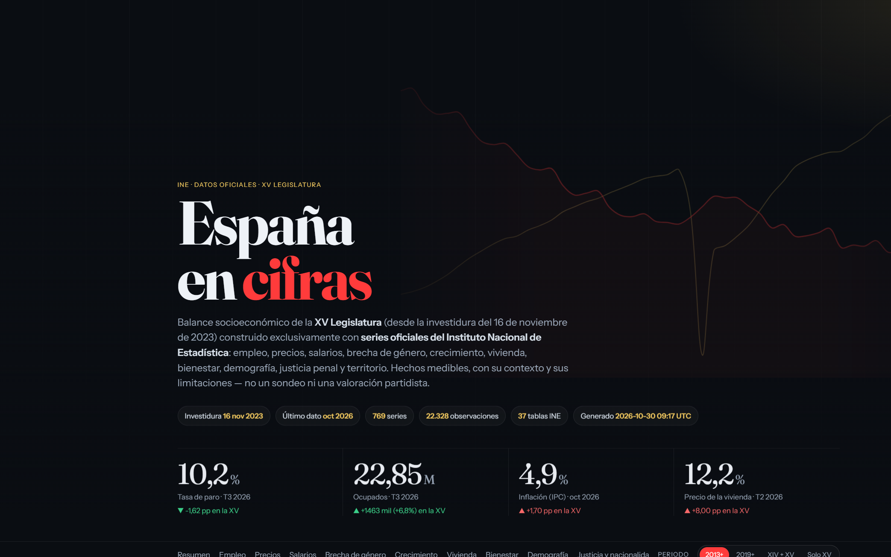

</div>

---

## Qué es este proyecto

Un análisis de datos de principio a fin sobre el **desempeño económico y social de España durante la XV Legislatura** (desde la investidura del 16 de noviembre de 2023), pensado para contrastar el debate preelectoral con datos oficiales.

- **Fuente única y oficial:** todas las cifras salen de la API pública del **Instituto Nacional de Estadística** (INE). No hay datos escritos a mano.
- **Reproducible:** un solo comando descarga, limpia, analiza y regenera el notebook, las figuras y el dashboard.
- **Riguroso:** se compara siempre con el punto de partida de la legislatura y con la anterior (XIV). Los indicadores se normalizan para poder sumarlos y las tasas se ajustan demográficamente cuando hace falta. Cada gráfico lleva sus limitaciones.
- **Neutral:** el proyecto describe hechos medibles. No asigna causalidad al Gobierno ni predice resultados electorales.

### Entregables

| | Archivo | Descripción |
|---|---|---|
| 📓 | [`notebooks/eda_xv_legislatura.ipynb`](notebooks/eda_xv_legislatura.ipynb) | EDA completo en 15 secciones: calidad de datos, scorecard, empleo, precios, salarios, brecha de género, crecimiento, vivienda, bienestar, demografía, justicia y nacionalidad, territorio, macro y conclusiones |
| 📊 | [`dashboard/index.html`](dashboard/index.html) | Dashboard autocontenido (un único HTML con los datos embebidos): 14 secciones, 70 gráficos, selector de periodo, filtros y tabla territorial ordenable |
| 🖼️ | [`docs/img/`](docs/img) | 30 figuras del EDA en PNG y capturas del dashboard |
| ⚙️ | [`src/`](src) | Pipeline de extracción y capa analítica compartida por el notebook y el dashboard |

---

## Hallazgos principales

> Datos hasta octubre de 2026. Las cifras se recalculan automáticamente al regenerar el proyecto.

| Ámbito | Resultado | Lectura |
|---|---|---|
| **Empleo** | Paro del **11,8% al 10,2%** (−1,6 pp) · **+1,46 millones** de ocupados, hasta 22,85 M | Ocupación en máximos de la serie. El paro juvenil (23,3%) sigue siendo 2,3 veces la media |
| **Temporalidad** | **15,3%** de asalariados temporales | Mínimo de la serie. El gran salto lo dio la reforma laboral de 2022 (de ~25% a ~17%) |
| **Precios** | IPC **4,9%** (oct 2026), subyacente 3,1% | Repunte por la energía (+20,9%) sin contagio pleno a la inflación de fondo |
| **Salarios** | Salario real **+1,8%** desde el inicio de la XV | Recuperación modesta tras la pérdida de 2021-2022. El percentil 10 crece mucho más que el 90 (efecto del SMI) |
| **Brecha de género** | Brecha por hora del **15,9% (2009) al 8,0% (2024)** | Se reduce a la mitad por hora; en ganancia anual sigue en el 16% por la mayor parcialidad femenina |
| **Crecimiento** | PIB **+2,7%** interanual · **+12,6%** sobre el nivel previo a la COVID | Crecimiento fuerte pero extensivo: la productividad por hora apenas avanza |
| **Vivienda** | IPV **+12,2%** anual · desde 2015, precios **+100%** frente a salarios **+28%** | El gran suspenso: índice de esfuerzo en 156 (2015 = 100) |
| **Bienestar** | AROPE **25,7%** · Gini **30,8** | Mínimos de la serie, pero la pobreza infantil (~34%) no mejora |
| **Demografía** | **49,7 M** de residentes, **14,8%** extranjeros | El crecimiento de la población es casi todo inmigración; los nacimientos, cerca de mínimos |
| **Justicia** | Ratio de condenados extranjeros/españoles: **2,54× bruto → 1,81× ajustado** por edad y sexo | La mitad de la diferencia es demográfica, y el ratio ajustado baja desde 2,12 (2016) |
| **Territorio** | Dispersión del paro entre CCAA de **5,8 a 2,4 pp** | Convergencia fuerte, con un eje norte-sur muy marcado en paro y pobreza (r = 0,85) |
| **Macro** | Índice de miseria medio **13,7** (XIV: 17,8) | La combinación paro + inflación más favorable de la muestra |

**Balance:** 14 de los 16 indicadores del scorecard mejoran desde el inicio de la legislatura. Los dos frentes negativos son la **vivienda** y el repunte de la **inflación general**.

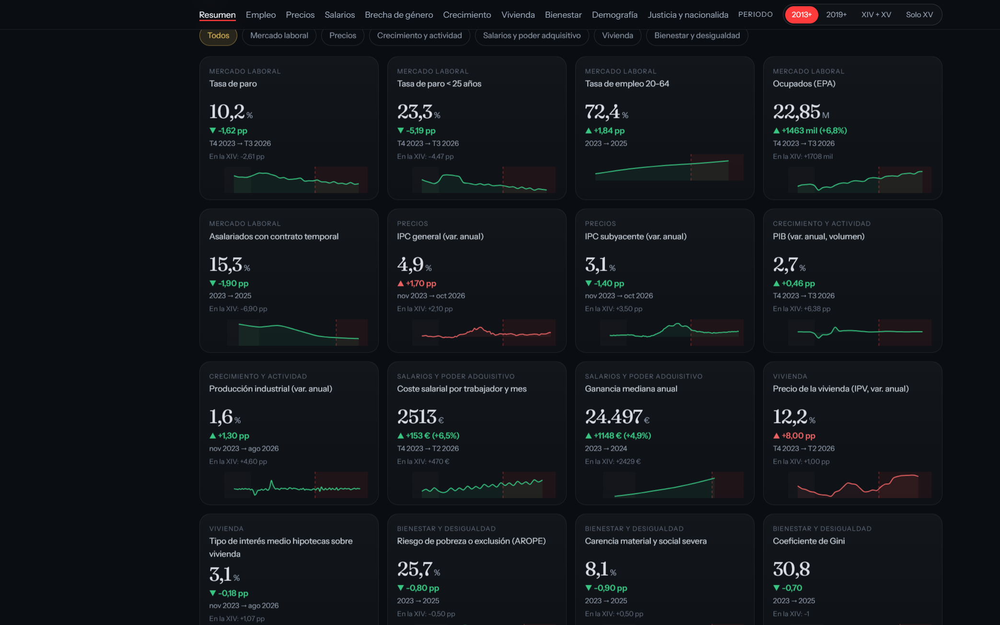

---

## El EDA en imágenes

<table>
<tr>
<td width="50%">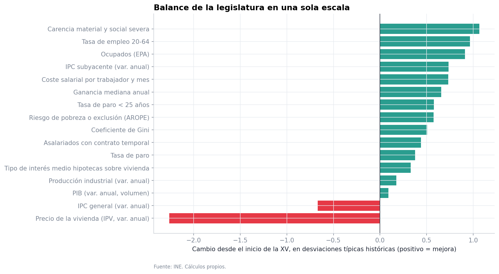<br/><sub><b>Balance en una sola escala.</b> Cambio de cada indicador en desviaciones típicas históricas.</sub></td>
<td width="50%">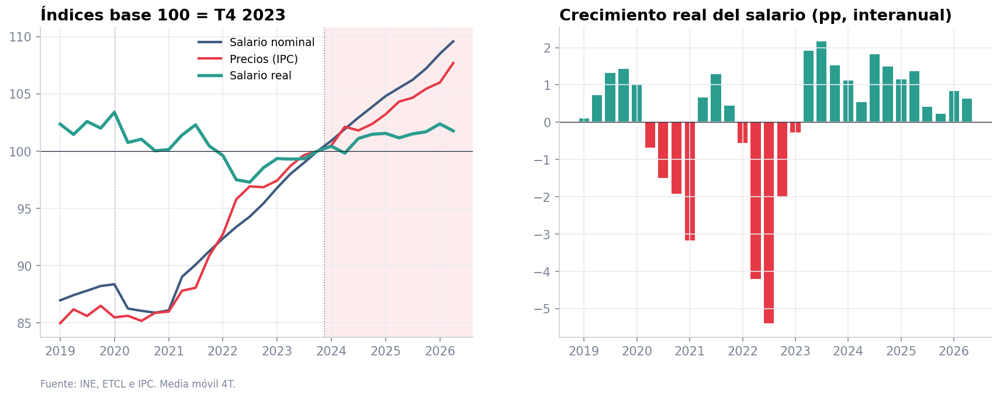<br/><sub><b>Poder adquisitivo.</b> Salario nominal deflactado por el IPC, base 100 = inicio de la XV.</sub></td>
</tr>
<tr>
<td>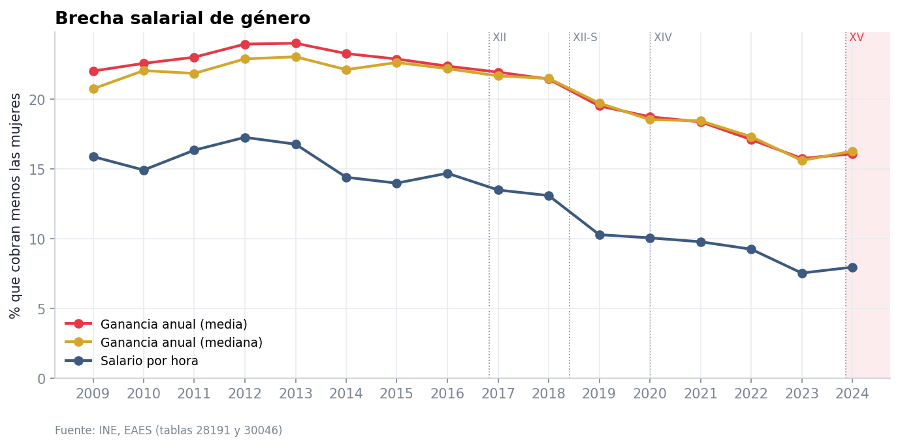<br/><sub><b>Brecha salarial de género</b> en tres medidas: anual media, anual mediana y por hora.</sub></td>
<td>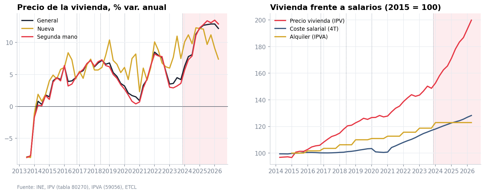<br/><sub><b>Vivienda.</b> Precio de compraventa frente a salarios, base 2015.</sub></td>
</tr>
<tr>
<td>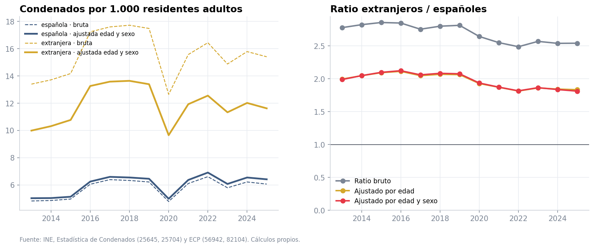<br/><sub><b>Condenas por nacionalidad.</b> Tasas brutas frente a tasas estandarizadas por edad y sexo.</sub></td>
<td>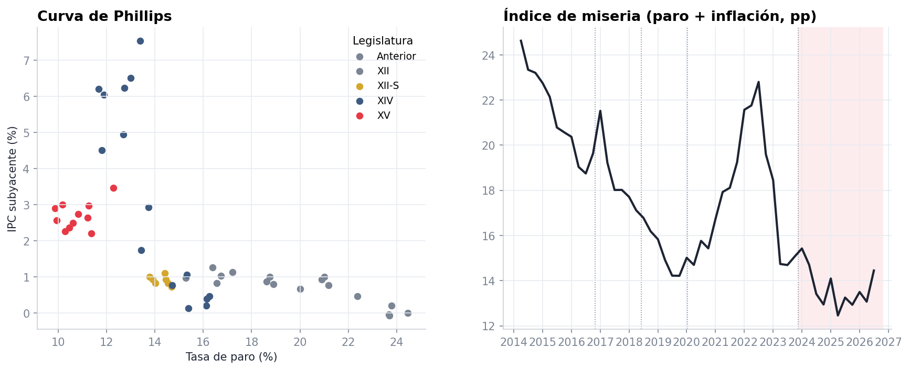<br/><sub><b>Curva de Phillips</b> por legislatura: paro frente a inflación subyacente.</sub></td>
</tr>
<tr>
<td>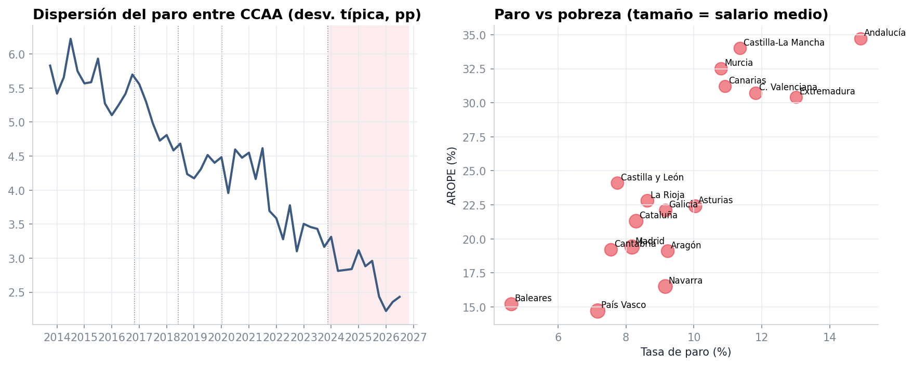<br/><sub><b>Convergencia sigma</b> del paro entre comunidades autónomas.</sub></td>
<td>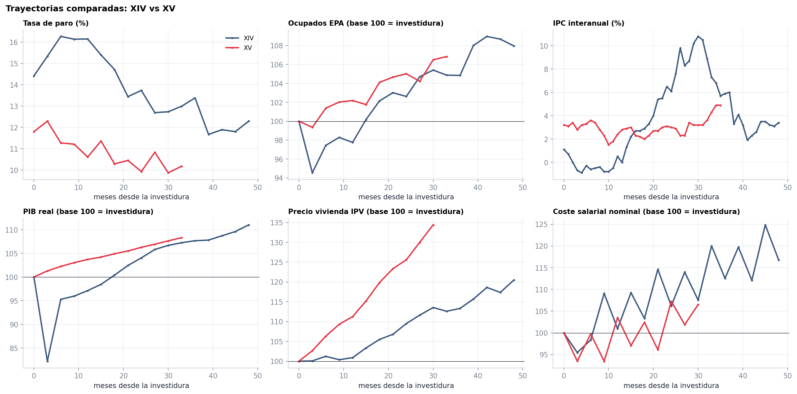<br/><sub><b>Event study:</b> XIV y XV alineadas por meses desde la investidura.</sub></td>
</tr>
</table>

---

## El dashboard

Un único `index.html` (~285 KB, sin servidor ni dependencias locales) con el mismo diseño editorial oscuro en todas las secciones: tipografías Fraunces e Instrument Sans, acentos rojo y oro, Chart.js 4.

- **Selector global de periodo** (2013+, 2019+, XIV + XV, solo XV) que recorta todos los gráficos temporales.
- **Sombreado de legislaturas** en cada serie temporal y línea de inicio de la XV.
- **Scorecard** con *sparklines*, filtros por bloque y comparación con la XIV.
- **Brecha de género** por ocupación, actividad, comunidad y sector.
- **Justicia y nacionalidad**, con advertencias metodológicas explícitas, tasas brutas frente a ajustadas, estructura por edad y peso por tipo de delito.
- **Territorio** con selector de métrica, tabla ordenable coloreada respecto a la media nacional y diagrama de dispersión paro–pobreza.
- **XIV vs XV** con *event study* interactivo, curva de Phillips, índice de miseria y matriz de correlaciones.
- Metodología, glosario y **tabla de fuentes** con enlace a cada tabla original del INE.

<table>
<tr>
<td width="50%">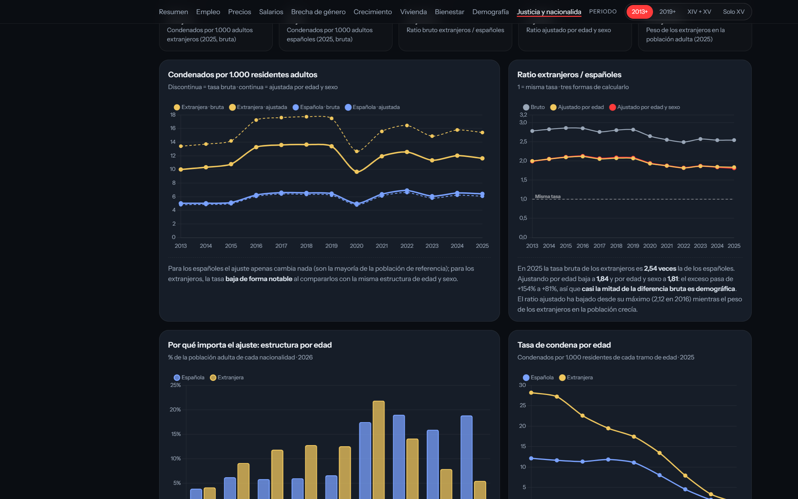</td>
<td width="50%">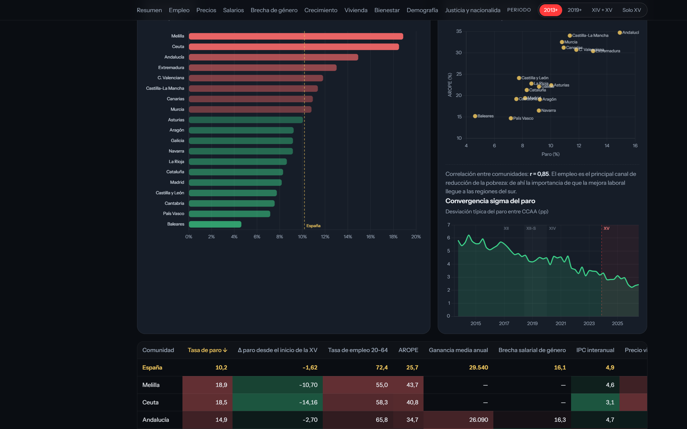</td>
</tr>
</table>

Para verlo basta con abrir `dashboard/index.html` en el navegador. Si el navegador bloquea archivos locales, sírvelo con `python -m http.server` y ve a `http://localhost:8000/dashboard/`.

---

## Cómo ejecutarlo

```bash
git clone <este-repo> && cd repo_port_spain
python -m venv .venv && source .venv/bin/activate   # Windows: .venv\Scripts\activate
pip install -r requirements.txt

python run_all.py              # pipeline + dashboard + notebook (≈ 2-3 min)
python run_all.py --refresh    # fuerza la descarga de todas las tablas del INE
```

Pasos sueltos:

```bash
python -m src.pipeline          # descarga y limpia → data/processed/
python -m src.build_dashboard   # genera dashboard/index.html
python scripts/build_notebook.py && jupyter nbconvert --to notebook --execute --inplace notebooks/eda_xv_legislatura.ipynb
```

No hace falta clave de API. Las respuestas crudas se cachean 24 h en `data/raw/`, que está excluida del repositorio.

---

## Estructura

```
repo_port_spain/
├── run_all.py                  # orquestador de extremo a extremo
├── requirements.txt
├── src/
│   ├── ine_client.py           # cliente de la API Tempus3 (reintentos, peticiones asíncronas del INE)
│   ├── catalog.py              # catálogo declarativo: 93 indicadores, tabla, regex, unidad, dirección deseable
│   ├── pipeline.py             # descarga → selección de series → formato largo tidy → CSV
│   ├── analytics.py            # capa analítica común (KPIs, salario real, brecha, tasas estandarizadas…)
│   ├── plotting.py             # estilo de las figuras del EDA
│   ├── build_dashboard.py      # serializa la analítica a JSON y la inyecta en la plantilla
│   └── templates/
│       ├── dashboard.html      # maquetación y estilos
│       └── dashboard.js        # gráficos e interacción (Chart.js)
├── scripts/
│   └── build_notebook.py       # genera el notebook del EDA (celdas de markdown y código)
├── notebooks/
│   └── eda_xv_legislatura.ipynb
├── data/
│   ├── raw/                    # caché de la API (ignorada por git)
│   └── processed/
│       ├── series_long.csv     # key, dim, fecha, año, periodo, valor
│       └── catalog.csv         # metadatos, cobertura y enlace a cada tabla INE
├── dashboard/
│   └── index.html              # dashboard autocontenido
└── docs/img/                   # figuras del EDA y capturas del dashboard
```

### Decisiones de diseño

- **Catálogo declarativo en lugar de IDs de serie.** Los códigos de serie del INE cambian con los cambios de base. Aquí cada indicador se localiza por el **nombre oficial** de la serie dentro de su tabla (coincidencia exacta o expresión regular con un grupo `dim` para las series por CCAA, sector o edad). Si el INE añade o renombra algo, el informe de cobertura lo detecta.
- **Una sola capa analítica.** El notebook y el dashboard llaman a las mismas funciones de `src/analytics.py`, así que no pueden contradecirse.
- **Textos que se reescriben con los datos.** Los hallazgos automáticos (`insights()`) y las notas numéricas del dashboard se calculan en cada ejecución; nada depende de cifras fijadas a mano.

---

## Metodología

| Concepto | Cómo se calcula |
|---|---|
| **Inicio de legislatura** | Último dato cuyo periodo de referencia empieza antes de la investidura (17-11-2023 para la XV, 8-1-2020 para la XIV): T4 2023 en trimestrales, nov 2023 en mensuales |
| **Balance en escala común** | Cambio desde el inicio de la XV dividido por la desviación típica histórica (2014+) de la serie, con el signo orientado según la dirección deseable |
| **Salario real** | Coste salarial ETCL (media móvil de 4 trimestres) deflactado por el IPC trimestral medio |
| **Índice de esfuerzo** | Índice IPV / índice salarial, ambos con base 2015 = 100 |
| **Brecha de género** | (H − M) / H × 100 sobre la Encuesta de Estructura Salarial. Brecha no ajustada |
| **Tasas de condena** | Condenados por 1.000 residentes de 18+ años. Población ECP por nacionalidad, sexo y edad (media anual); extranjeros = total − españoles. Los grupos quinquenales se reparten en edades simples y se reagrupan en los tramos de la estadística de condenados. **Estandarización directa** por edad y por edad × sexo con la población adulta total del mismo año como referencia |
| **Convergencia sigma** | Desviación típica del paro entre las 17 CCAA (sin Ceuta ni Melilla) |
| **Event study** | Series alineadas por meses desde cada investidura; en índices, base 100 = mes de la investidura |

### Limitaciones

- **Correlación temporal no es causalidad.** Influyen el ciclo, la política monetaria del BCE, los fondos europeos y los shocks externos (energía, guerra, pandemia).
- Las series anuales llegan con **1-2 años de retraso** (Encuesta de Estructura Salarial, Encuesta de Condiciones de Vida y Estadística de Condenados).
- El paro EPA **no está desestacionalizado** en la fuente utilizada.
- **Condenas ≠ delitos.** El numerador incluye a no residentes, la nacionalidad no equivale al origen y la diferencia residual tras el ajuste recoge factores socioeconómicos no observados.
- La comparación XIV–XV describe **contextos distintos**: la XIV empezó justo antes de la COVID.

---

## Fuentes (INE)

Operaciones estadísticas utilizadas, todas vía la API JSON Tempus3 (`servicios.ine.es/wstempus`):

**EPA** (Encuesta de Población Activa) · **IPC** · **CNTR** (Contabilidad Nacional Trimestral) · **ETCL** (Encuesta Trimestral de Coste Laboral, incluidas las vacantes) · **EES** (Encuesta de Estructura Salarial) · **IPI** · **Sociedades Mercantiles** · **FRONTUR / EGATUR** · **IPV** (Índice de Precios de Vivienda) · **IPVA** (alquiler) · **Hipotecas** · **ECV** (Encuesta de Condiciones de Vida) · **ECP** (Estadística Continua de Población) · **Estadística de Migraciones** · **Estimación mensual de nacimientos** · **Estadística de Condenados**.

La lista completa de las 37 tablas, con enlace a cada una, está en `data/processed/catalog.csv` y en la sección *Fuentes* del dashboard.

Datos del INE reutilizados según sus condiciones de reutilización de información pública, citando la fuente. Cálculos y visualizaciones propios.

---

<div align="center">
<sub>Proyecto de portfolio · Python · pandas · matplotlib · seaborn · Chart.js · API INE</sub>
</div>
